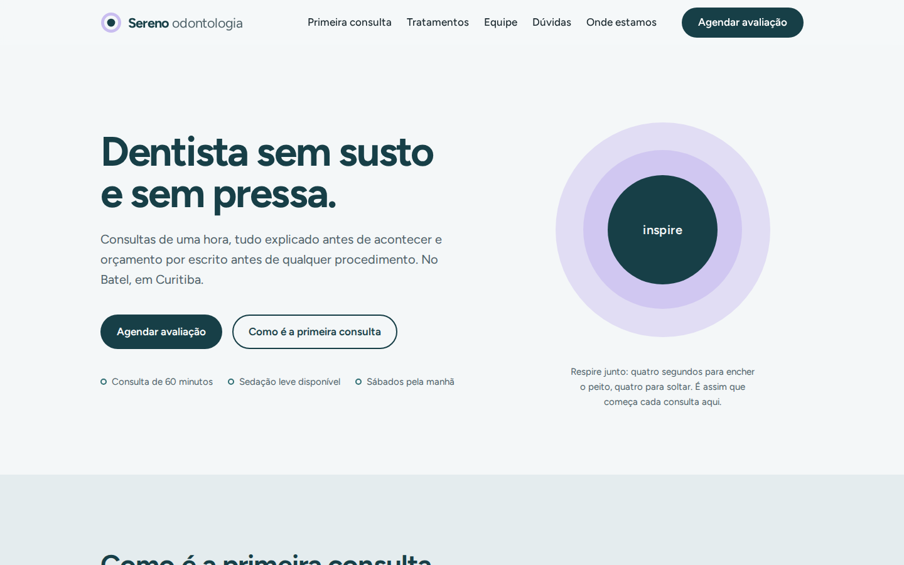
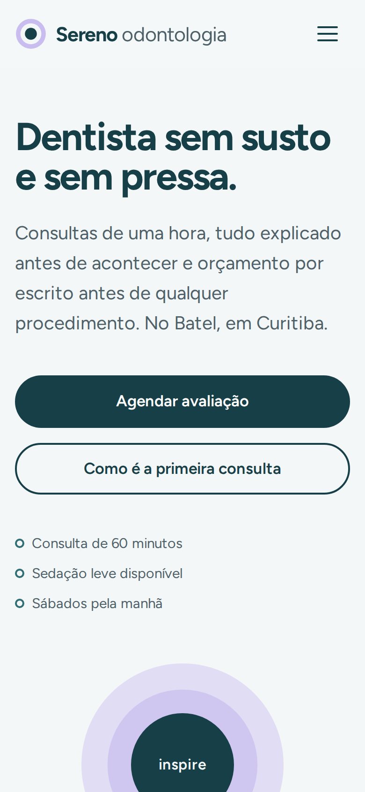

# Sereno Odontologia: landing page

Landing page de uma **clínica odontológica fictícia** para pacientes com medo de dentista, feita com **HTML, CSS e JavaScript puros**, sem frameworks e sem dependências.

🔗 **Demo:** https://ruan-unico.github.io/sereno-odontologia/

<p align="center">
  
  &nbsp;
  
</p>

## Sobre o projeto

A Sereno não existe: é um projeto de portfólio que simula um pedido real de cliente, uma landing page para uma clínica gerar agendamentos pelo WhatsApp, que é um dos pedidos mais comuns em plataformas de freelance.

O conceito parte do público: muita gente adia o dentista por medo. Por isso a página vende **calma e transparência** (consulta sem pressa, tudo explicado antes, orçamento por escrito) e abre com um círculo que "respira" devagar, convidando o visitante a respirar junto.

## Funcionalidades

- **Agendamento pelo WhatsApp:** o formulário valida os dados e abre o WhatsApp com a mensagem pronta. Não existe backend: nenhum dado é enviado ou guardado pelo site.
- **Validação em português e acessível:** mensagens claras embaixo de cada campo, foco automático no primeiro erro e `aria-invalid` para leitores de tela.
- **Máscara de telefone** enquanto a pessoa digita: `41999998888` vira `(41) 99999-8888`.
- **Menu responsivo** que vira gaveta no celular, fecha com `Esc` e devolve o foco ao botão.
- **Perguntas frequentes** com `<details>`, que funcionam até sem JavaScript.
- **Respeita "reduzir movimento":** quem ativou essa opção no sistema não vê a animação.

## Resultados no Lighthouse

Medido em 01/10/2026, em servidor local.

| | Performance | Acessibilidade | Boas práticas | Peso total |
|---|:---:|:---:|:---:|:---:|
| Celular | 99 | 100 | 100 | 65 KB |
| Computador | 100 | 100 | 100 | 65 KB |

O SEO aparece como 60 de propósito: a página usa `<meta name="robots" content="noindex">` para que uma clínica fictícia não apareça no Google para quem procura um dentista de verdade. Os demais itens de SEO passam. Em um projeto real, basta remover essa linha.

## Decisões técnicas

**Sem framework.** Uma landing page é conteúdo estático com pouca interação. HTML, CSS e JS puros resultam em 65 KB no total, carregamento instantâneo e nenhum passo de build. React ou similares só aumentariam o peso sem trazer benefício aqui.

**HTML semântico.** `header`, `nav`, `main`, `section` com `aria-labelledby`, `ol` para a sequência da primeira consulta (que realmente é uma ordem), `dl` para os tratamentos (termo e descrição), `blockquote` com `figcaption` para os depoimentos e `address` para o endereço. Isso ajuda leitores de tela e mecanismos de busca a entenderem a página.

**CSS organizado com tokens.** Cores, tamanhos e espaçamentos ficam em variáveis no `:root`. Para adaptar a página a outro cliente, troca-se a paleta em um só lugar. As classes seguem a convenção BEM (`bloco__elemento--modificador`), com nomes em português. A tipografia é fluida com `clamp()`, então o texto cresce de forma proporcional entre celular e computador, sem dezenas de media queries.

**JavaScript em módulos.** Cada responsabilidade em um arquivo: `menu.js`, `formulario.js`, `validacao.js` e `config.js`. A lógica de validação fica em **funções puras**, que não tocam no HTML. Por isso ela pode ser testada no Node sem navegador.

**Performance.** A fonte (Figtree, variável) é servida pelo próprio site, em um único arquivo de 20 KB com todos os pesos, e é pré-carregada com `preload`. Não há imagens pesadas: o símbolo e o círculo animado são CSS e SVG. A animação usa só `transform` e `opacity`, que não forçam o navegador a recalcular o layout.

**Acessibilidade.** Link "pular para o conteúdo", foco visível em todos os elementos, contraste adequado, áreas de toque de pelo menos 48 px, rótulos em todos os campos e `role="status"` para anunciar o resultado do envio.

**Privacidade.** O formulário não envia dados para lugar nenhum: ele só monta um link `wa.me` com a mensagem codificada por `encodeURIComponent`. O visitante decide no WhatsApp se envia ou não.

## Estrutura

```
├── index.html
├── assets/
│   ├── css/style.css         # tokens, componentes e seções, nessa ordem
│   ├── js/
│   │   ├── main.js           # ponto de entrada
│   │   ├── menu.js           # menu do celular
│   │   ├── formulario.js     # liga a validação ao HTML e abre o WhatsApp
│   │   ├── validacao.js      # funções puras (testadas)
│   │   └── config.js         # número do WhatsApp e nome da clínica
│   ├── fonts/                # Figtree (licença OFL)
│   └── img/                  # favicon e imagem de compartilhamento
├── test/validacao.test.js
├── docs/                     # imagens deste README
└── .github/workflows/deploy.yml
```

## Como rodar

Não há nada para instalar. Como o JavaScript usa módulos, a página precisa ser aberta por um servidor local, e não com dois cliques no arquivo:

```bash
npm run dev                  # usa o pacote "serve" via npx
# ou: python -m http.server
```

No VS Code, a extensão **Live Server** também funciona.

### Testes

Os testes usam o executor nativo do Node.js (versão 20 ou superior):

```bash
npm test
```

Eles cobrem a máscara do telefone, a validação de nome, telefone e DDD, e a montagem da mensagem e do link do WhatsApp, incluindo acentos e quebras de linha.

## Publicação

A cada `push` na branch `main`, o GitHub Actions roda os testes e, se passarem, publica no GitHub Pages (`.github/workflows/deploy.yml`). Para ativar, vá em **Settings → Pages → Source** e escolha **GitHub Actions**.

## Como adaptar para um cliente real

1. Troque o número em `assets/js/config.js`.
2. Ajuste as cores nas variáveis do topo de `assets/css/style.css`.
3. Substitua os textos, o endereço e a equipe no `index.html`.
4. Remova a linha `noindex` e os avisos de conteúdo fictício.
5. Atualize a imagem `assets/img/og-image.png`, que aparece quando o link é compartilhado.

## Autor

Feito por **Ruan Souza**, estudante de Análise e Desenvolvimento de Sistemas no Senac PR.
[LinkedIn](https://www.linkedin.com/in/ruan-souzadev) · [Outros projetos](https://github.com/ruan-unico)

Licença [MIT](LICENSE). A fonte Figtree é distribuída sob a SIL Open Font License.
